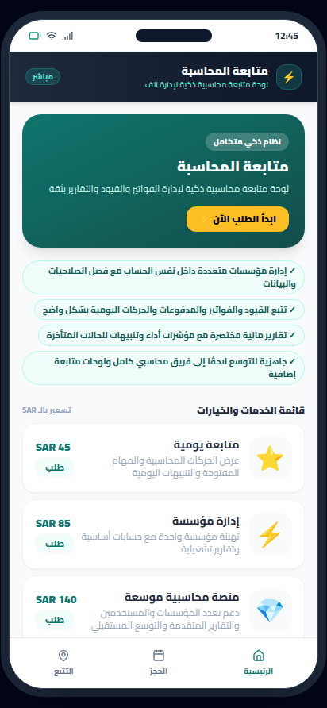
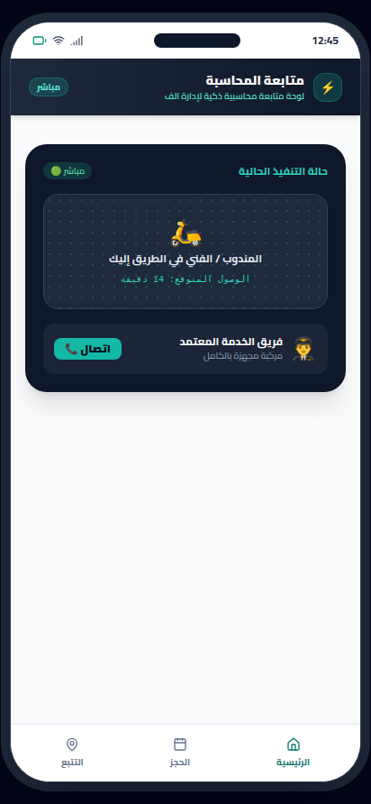
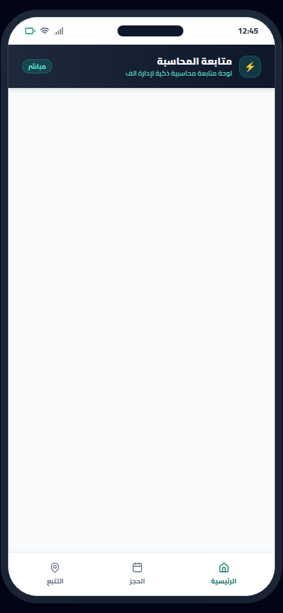

# متابعة المحاسبة (Accounting Follow-up)


-orange?style=flat)


> **لوحة متابعة محاسبية ذكية لإدارة الفواتير والقيود والتقارير بثقة**

---

## 📸 Real App Screenshots (لقطات حقيقية من التطبيق)

| الشاشة الرئيسية والخدمات | تفاصيل الحجز والتسعير | التتبع المباشر وحالة الطلب |
|:---:|:---:|:---:|
|  |  |  |

---

## 📱 Project Overview (نظرة عامة على المشروع)

هذا الحل يقترح تطبيقًا محاسبيًا موجهًا لمتابعة الأعمال متعددة المؤسسات داخل تجربة Android نظيفة وسريعة، مع تركيز واضح على وضوح الحالة المالية، سهولة إدخال العمليات، وإظهار الملخصات المهمة للمحاسب وصاحب العمل. القيمة المضافة الأساسية هي تحويل العمل المحاسبي اليومي إلى تدفق منظم: مؤسسة، حسابات، قيود، فواتير، مدفوعات، وتنبيهات، مع قابلية التوسع لاحقًا إلى فريق كامل وصلاحيات متعددة دون إعادة بناء المنتج من الصفر.

هندسيًا، يُفضّل تطبيق Clean Architecture مع فصل طبقات العرض والمنطق والبيانات، وRepository pattern مع مصادر محلية وسحابية، ودعم مزامنة انتقائية لكل مؤسسة، وتدقيق Audit Log لكل تغيير مالي. الواجهة ينبغي أن تكون مبنية على لوحات مختصرة، بحث سريع، فلاتر، وحالات واضحة، بينما يوفّر الربط السحابي نسخًا احتياطيًا ومزامنة آمنة، مع آليات تحقق من النزاهة، منع التكرار، وتوقيع العمليات الحساسة لضمان موثوقية المحاسبة على المدى الطويل.

---

## ✨ Core Features (المميزات الرئيسية)

- **إدارة مؤسسات متعددة داخل نفس الحساب مع فصل الصلاحيات والبيانات**
- **تتبع القيود والفواتير والمدفوعات والحركات اليومية بشكل واضح**
- **تقارير مالية مختصرة مع مؤشرات أداء وتنبيهات للحالات المتأخرة**
- **جاهزية للتوسع لاحقًا إلى فريق محاسبي كامل ولوحات متابعة إضافية**

---

## 🏛️ Clean Architecture Layers

```
sa.mostaql.accountingfollowup
├── data/
│   └── FinancialAccountRepository.kt          # Flow-based reactive data source
├── model/
│   └── FinancialAccountModels.kt              # Immutable business data structures
└── ui/
    ├── FinancialAccountViewModel.kt           # StateFlow UI state holder
    └── FinancialAccountScreens.kt             # Jetpack Compose Material 3 screens
```

---

## 🛡️ Architectural Invariants & Security Threats

### Invariants (القواعد الصارمة):
- **`multiTenantIsolation`**: Rule: كل مؤسسة هي نطاق بيانات مستقل تمامًا، ولا يجوز ظهور أي حركة أو فاتورة أو تقرير خارج نطاق المؤسسة المحددة للمستخدم.
- **`moneyStateConsistency`**: Rule: أي عملية مالية يجب أن تمر بحالات واضحة غير قابلة للتناقض؛ لا يتم اعتماد القيد أو السداد إلا مرة واحدة، وأي تعديل لاحق يسجل كحركة تصحيحية مع أثر تدقيقي كامل.

### Threat Model (حماية البيانات والتهديدات):
- حماية البيانات المالية والهوية الضريبية من التسريب أو العرض عبر صلاحيات غير دقيقة
- منع التلاعب بالمدفوعات أو تكرار الإشعارات/العمليات عبر توقيع الطلبات والتحقق من التكرار وسجل تدقيق غير قابل للتلاعب

---

## 🚀 Build Instructions

```bash
# Clone the repository
git clone https://github.com/hmoushim0-cloud/app-1289287.git
cd app-1289287

# Assemble Debug APK
./gradlew assembleDebug
```

---

### 🌐 Live Showcase & Cloud Verification
- **Verified Showcase:** [https://hmoushim0-cloud.github.io/live-previews/?id=1289287](https://hmoushim0-cloud.github.io/live-previews/?id=1289287)
